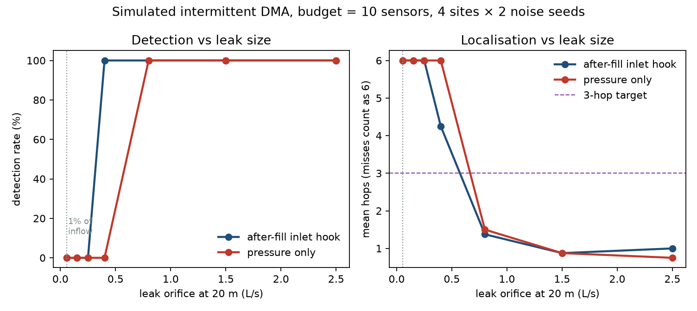
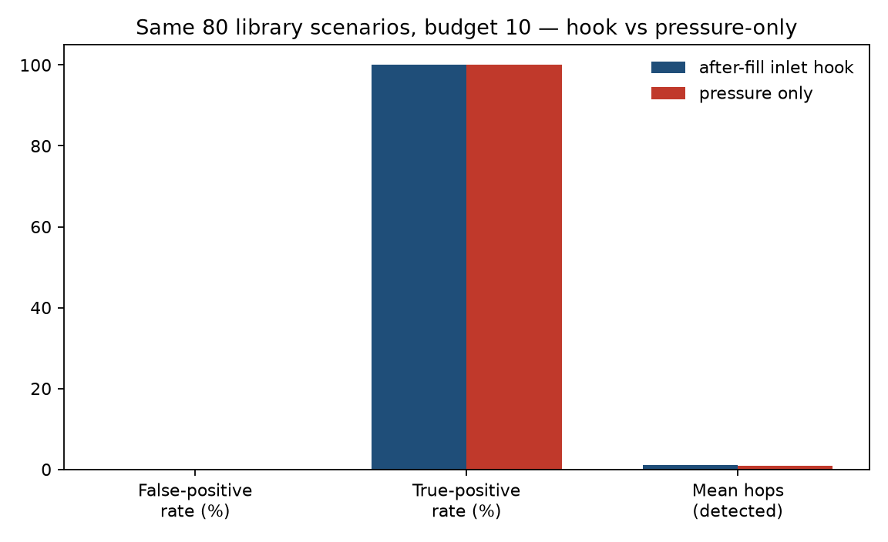
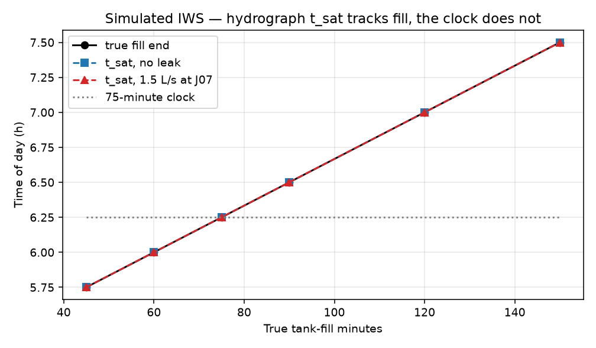

# M.A.J.I — leftover flow after tanks fill

**Final technical report**  
Khalifa University–UNESCO Global Water Hackathon 2026  
Theme 3 · Smart, Digital, and AI-Enabled Water Systems  
Team RKO · Registration CMAT-00064 · 1 November 2026

**Team.** Blessings Wanjiku (lead), Ravine Rianga, Faruoq Muhammed, Francis Musau, Vivian Njoroge, Peter Kariuki.  
**Advisor.** Prof. Easter Wega. **Mentor.** Prof. Sarah Mugo.

**Access.** https://github.com/Nosh-thee-techy/maji-water-network-ai  
**TRL.** 3–4 (reproducible simulation prototype). Target 5–6 after a 90-day single-DMA pilot.

Every number in this report is labelled **simulated**, **benchmark**, or **estimated**. Nothing here is a field measurement. Where a number could not be produced honestly, it is omitted rather than invented.

---

## Abstract

Most leak-detection methods assume a pressurised night. About one billion people live on intermittent water supply (IWS). Household tanks keep drawing until they fill, so classic minimum-night-flow (MNF) is false. Al-Washali, Sharma, and Kennedy (2019) showed the correct test on a 1,028-customer DMA in Zarqa, Jordan: wait until tanks saturate, then leftover inlet flow is leakage. They needed about 63 hours of continuous supply. That procedure is not a daily product on a rationed network.

M.A.J.I applies the same leftover-flow test **inside each rationing window**. Customer demand is storage-limited. A leak is an orifice (emitter, Q proportional to sqrt(P)). After the inlet hydrograph drops (`t_sat`), leftover litres per second is the leak test. Sparse pressure then shrinks the dig list; it does not call the leak.

A physics-informed graph net trained on this DMA reconstructed nodal pressure (1.15 m MAE on 45 held-out simulated scenarios) and **detected no leaks** (TPR 0.00). The detector we ship is leftover flow plus a frozen-sensitivity L1 fit. The net is a pressure twin only.

On an 18-node schematic DMA the after-fill hook detects 0.40 L/s where pressure-only is still blind. The white paper’s 1% of DMA inflow target (0.056 L/s) is invisible under 0.3 m sensor noise; we do not claim it. Official BattLeDIM 2019 scoring of L-Town SCADA lost to the winners (TPR 0.30, €144,030 vs €260,562–€264,873). That run is a labelled continuous-supply negative control and is never blended with IWS numbers.

Software: EPANET 2.2 / WNTR scenario library, emitter-calibration baseline, IWS duty-cycle observation model, FastAPI leftover engine, four-page operator desk. Public repository as above.

---

## 1. Problem statement

### 1.1 Why night-flow fails on IWS

On a continuously supplied district metered area (DMA), leakage is estimated from minimum night flow, typically 02:00–04:00. Customers are asleep, so inlet flow is approximately leakage plus a small legitimate night use (Farley & Trow; Lambert; Liemberger). TaKaDu, UK nightline practice, and most “AI leak” products are this identity with better statistics and event desks.

On intermittent supply that identity is false. Household ground and roof tanks keep drawing until they are full, even at 03:00. Al-Washali et al. (2019) held a Zarqa DMA in continuous supply until the inflow hydrograph started to repeat (~63 hours). Only then was leftover inflow leakage. Repeating that conversion on a rationed network is operationally unrealistic: it spends water the utility does not have and requires a schedule the operations room cannot keep.

Ashdown Park / VEI work on Harare IWS DMAs reached the same operational conclusion from the other direction: **flow detects better than pressure** on intermittent districts, and utility supply irregularity is harder than customer demand. Nairobi and Harare already prefer flow sensors for NRW. A 15-sensor pressure grid without a trusted inlet meter is the wrong first install.

### 1.2 Health is the same pressure story

Kumpel and Nelson (2014) found indicator bacteria common below ~10 psi (~7 m), even with chlorine present. When the inlet is closed the DMA is slack; intrusion is possible at any opening. That is not a separate water-quality product. It is a low-pressure / empty-pipe problem. On the schematic DMA used here, off-window slack is **trivial** (the network is drained by construction). In-window crossings of 7 m are rare (~0.023% of node-steps). We therefore do **not** headline intrusion as a result. We name the prior and report the numbers.

### 1.3 Context numbers (not produced by this repository)

| Claim | Number | Label |
| --- | --- | --- |
| Global NRW volume / value | 126 billion m³/y, ~US$39 billion | literature (Liemberger & Wyatt 2019) |
| Kenya public-provider NRW | 48% (2024/25) | WASREB, as cited in the white paper |
| People on intermittent supply | ~1 billion | literature (Taylor et al. 2018) |
| Intrusion prior | ~7 m (~10 psi) | literature (Kumpel & Nelson 2014); starting prior, not a constant |

M.A.J.I is not a general leak-detection application. It is MNF logic on a network that has no night.

---

## 2. Scientific hook

Customer demand is storage-limited: once a household tank fills, draw stops regardless of pressure. A leak is an emitter: it keeps drawing as long as there is pressure. After tanks saturate, leftover inlet flow is the leak.

On the 18-node schematic DMA, 12 h excerpt (`fig_storage_vs_leak.png` in the caption log; the identity is also the demo-leak window):

| Quantity | No leak | 1.5 L/s leak at J07 | Label |
| --- | --- | --- | --- |
| Inlet flow during tank-fill | 5.55 L/s | higher by the orifice | simulated |
| Inlet flow after tank-fill, inlet still open | ≈ 0 L/s | 1.41 L/s | simulated |
| Off-window pressure (clamped) | 0 m | 0 m | simulated (post-process) |

Household tanks are **not** EPANET tank elements. Demand is a pattern that is active only for the first N minutes of each 05:00–09:00 and 17:00–21:00 window, then zero. This is the storage-limited simplification named in the white paper. Leaks are junction emitters with EPANET default exponent 0.5: Q = C × P^0.5, C set so the orifice delivers a stated L/s at a 20 m reference head.

The deployable change-point is on the **inlet hydrograph**, not a 75-minute clock. Sequence: high plateau (tanks drawing) → drop → lower plateau (leftover). We call the knee `t_sat`. A clock is a laboratory convenience. In code it is `CLOCK_FILL_MINUTES` and is used only as a fallback when the DMA looks continuously supplied (no knee).

Leftover is reported in L/s and as a performance-based contract (PBC) unit: leftover m³/day on **open hours**, not on 24 h. 1 L/s × 8 open hours = 28.8 m³/day, not 86.4. The test suite asserts that identity.

Three jobs, not interchangeable:

1. **Detection** — leftover litres per second after `t_sat`, with persistence.
2. **Localisation** — sparse L1 fit of a frozen no-leak sensitivity matrix. Output is hops, not “X% accuracy.”
3. **Reconstruction** — graph net fills nodal head from sparse sensors. Not used to call a leak.

---

## 3. Method

### 3.1 Network and hydraulics

One schematic DMA: 18 junctions (J00–J17), 25 pipes, one reservoir (R1). Looped core plus two dead-end laterals. J00 is the DMA inlet (zero customer demand). Not a traced utility GIS extract. Multi-topology generalisation is future work.

| Parameter | Value | Reason |
| --- | --- | --- |
| Hazen–Williams C | 120 on every pipe | Aged metallic / mixed; no per-pipe calibration |
| Pipe diameters | 40–110 mm | First-pass 80–200 mm had ~0.06 m peak headloss; leak signatures sat below 0.3 m sensor noise |
| Reservoir head | 38 m | With elevations 13.5–20 m, open-window nodal head ~12–22 m |
| Hydraulic step | 5 minutes | Matches the twin series |
| Scenario duration (library) | 48 h | Two full days, four rationing windows |
| Demand | EPANET 2.2 PDD, P_req = 20 m, P_min = 0 m | Storage-limited pattern, not tank objects |

Rationing is a binary inlet-pipe status: open 05:00–09:00 and 17:00–21:00; closed otherwise. No gradual valve, no pump curve, no source-head variation. EPANET / WNTR do not empty pipes of water. When the inlet is closed, PDD drives heads toward zero; we then **clamp off-window pressure to 0 m**. That is a post-process, not a two-phase air–water model. A fill / intrusion transient model is out of scope.

A leak slightly reduces delivered customer volume under PDD (less residual head in the fill window). A 1.5 L/s leak at J07 cut 12 h customer volume by about 3%. Tests require that customer volume does not *rise* with a leak, and that the PDD drop stays under 5%. We do not claim leak and demand are independent.

Unmetered demand is a tagged share of customer demand at selected nodes. Meter bias is a hidden under-registration applied only when computing billed volume. Solvers never see the bias parameter.

### 3.2 Scenario library

`python -m sim.generate` writes 300 scenarios × 48 h (default). 57 are zero-leak (19%). Library leak orifices are **0.8–3.0 L/s at 20 m** (about 14–55% of peak DMA inflow ≈ 5.6 L/s). That is larger than the white paper’s 1% target. The size sweep (Section 4.2) is a separate experiment.

Fill length is no longer fixed at 75 minutes. The generator draws from {45, 60, 75, 90, 120, 150} min so `t_sat` is tested off the clock. 75 minutes remains the demand default and the continuous-supply clock fallback.

A four-window demo pack (`results/demo`, 12 h) is generated by `sim/demo_library.py` so the operator desk runs without the 300-scenario library: clean, leak at J07 (1.5 L/s), long fill (120 min + same leak), valve did not open.

### 3.3 Observation model (`sim/observe.py`)

Solvers see only what a chamber logger would uplink: noisy pressure at placed sensors, noisy inlet flow, and valve position (1 / 0 / NaN). They never see leak labels or the clean field.

| Noise | Value |
| --- | --- |
| Pressure | σ_P = 0.30 m |
| Inlet flow | σ_Q = 0.15 L/s |

**IWS duty cycle** (not i.i.d. holes). Off-the-shelf DMA loggers default to “15 minutes forever.” That wastes battery off-window and is too coarse at the saturation knee.

| Phase | How we know | Sample | Uplink |
| --- | --- | --- | --- |
| Off-window | Valve closed, P ≈ 0, Q ≈ 0 | 15 min heartbeat | Daily or on exception |
| Open transient | Valve opens or ΔP ≳ 0.5 m | 1 Hz × 30–60 s | Immediate |
| Fill | Valve open, Q high plateau | 1 min flow + pressure | 15 min batch |
| Saturation | Change-point: Q drops and stays | — | Flag `t_sat` |
| After-fill plateau | Valve still open, post `t_sat` | 1 min for ≥30 min | Immediate if residual > threshold |
| Rest of window | After the 30 min hold | 5 min | 15 min batch |

Radio dropouts (3%, 1% cap on the leftover hold) apply only to uplinked steps. A continuously supplied DMA does not sleep. A missing after-fill record is a `sensor_failure` event, not a clean DMA.

The 300 × 48 h localisation table in Section 4.1 was scored under an earlier **i.i.d. 3% dropout** model. The duty-cycle model is scored on a live 24 × 12 h mixed-fill set (Section 4.4). **Do not blend the two.**

Placement is greedy signature-separability on the hydraulic model (`placement/greedy.py`), not a field survey. Budgets 5, 10, 15, 18 (all junctions).

### 3.4 Saturation and event types (`baseline/saturation.py`)

The 75-minute fill is a simulation convenience. In the field the utility does not know that number. Constants actually used:

| Constant | Value | Role |
| --- | --- | --- |
| OPEN_CHECK_MINUTES | 20 | First 20 min must show a fill surge, or the valve never opened |
| MIN_FILL_MINUTES | 20 | Do not declare saturation in the valve transient |
| MIN_AFTER_MINUTES | 30 | Need ≥30 min of after-fill to trust leftover (duty-cycle hold) |
| MIN_DROP_LPS | 0.80 | Drop from fill plateau to leftover (~5 × 0.15 L/s flow-noise σ) |
| VALVE_CLOSED_LPS | 0.30 | Scheduled-open but Q below this in the first 20 min → valve closed |
| VALVE_CLOSED_PRESSURE_M | 1.0 | Supporting pressure check |
| MIN_FINITE_FRAC | 0.40 | Fraction of finite samples required before we trust a window |
| PERSIST_STEPS | 4 | DBM-style: leftover must stay above threshold this many steps |
| DETECT threshold | 0.35 L/s | Operating point for leak vs no_leak |

`t_sat` is a two-means knee on the inlet. If no knee, the clock fallback is used and leftover is treated with more caution (`used_change_point = false`).

One event type per supply window:

| Type | Meaning |
| --- | --- |
| `leak` | Leftover persisted above 0.35 L/s |
| `no_leak` | Leftover persisted below 0.35 L/s |
| `valve_did_not_open` | Scheduled window, no fill surge |
| `sensor_failure` | After-fill (or the whole window) is missing |
| `still_filling` | Window stayed on the high plateau (no knee) |

### 3.5 Localisation (emitter-calibration baseline)

A no-leak hydraulic run plus a per-node sensitivity (signature) matrix is built once (`baseline/evaluate.py` → `build_noleak_and_sensitivity`). The matrix stays **frozen**. A Sunday / after-fill update (`baseline/recalibrate.py`) may shift the after-fill inlet baseline (and optionally fill-window pressure) only when leftover is already below 0.35 L/s. A leak-sized leftover is refused so the model cannot absorb a burst into “normal.”

Given noisy sensor pressure and inlet flow, `baseline/emitter_calibrate.py` estimates a sparse non-negative leak vector by L1 fit to the signatures. Ranked nodes plus hop radius are the dig list. Hungarian matching on the pipe graph (`baseline/graph_distance.py`) scores hops against truth in evaluation only. Solvers never receive leak labels.

### 3.6 Graph net (offline; not the detector)

`model/gnn.py` is a small message-passing net: sparse pressure in, full field + leak q out. Edge attributes include Hazen–Williams geometry. Training (`model/train.py`) uses reconstruction MSE, a leak-q term, and a physics residual. **No EPANET in the training loop.** Inputs are two aggregated windows per scenario (fill-window mean, after-fill mean), `in_dim = 8`. Full 5-minute sequences made training too slow for the time budget; those two windows are also what the baseline uses.

Ensemble (library result): 5 seeds, 80% row subsets, budget 10, 45 held-out scenarios. Spread is **simulation uncertainty**, not conformal coverage. There is no real-network calibration set.

A second, smaller trainer (`python -m model.recon`) writes `model/checkpoints/gnn_recon.pt` from 20 × 12 h scenarios × 25 epochs so the Twin page can load without the full ensemble. That checkpoint reconstructs demo windows. Leak TPR remains 0. The head is unused for the dig list (`leak_head_unused: true`).

### 3.7 Event lifecycle (`dashboard/lifecycle.py`)

State machine: `open` → `assigned` → `repaired` → `verified` (or `failed_verify`). Repair before assign is refused. Close only when leftover now is below 0.35 L/s or has dropped by ≥50%. A simulated repair is labelled. We do not implement a vendor work-order lock-in.

### 3.8 CIS ingest (`baseline/cis.py`)

CSV (`account_id`, `node`, `billed_m3`, optional `account_class`) plus leftover gives real vs commercial residual. `alarms_from_apparent = False`. Unmetered accounts are tagged, not punished. Apparent residual does not open a leak. Pressure cannot split theft from meter error.

### 3.9 Worked leftover unit

Demo leak window (J07, 1.5 L/s orifice). Solver leftover ≈ **1.45 L/s**. Two rationing windows × 4 hours = 8 open hours/day.

1.45 L/s × 8 h × 3600 / 1000 = **41.8 m³/day**.

That is the PBC line. 1 L/s × 8 h = 28.8 m³/day. The suite asserts the 28.8 identity so nobody reports 86.4 (a 24 h multiply on an 8 h valve).

### 3.10 Software map

| Path | Role |
| --- | --- |
| `sim/` | Network, schedule, storage-limited demand, emitters, balance, observe, generate, demo library |
| `placement/` | Greedy sensor placement |
| `baseline/` | Saturation, emitter calibrate, evaluate, recalibrate, explain, CIS |
| `model/` | GNN, train, evaluate, recon twin |
| `benchmarks/` | Continuous-DMA copy; official BattLeDIM 2019 scorer |
| `api/main.py` | HTTP leftover engine for the desk |
| `web/` | Four-page operator UI (Inlet, Network, Twin, Crew) |
| `dashboard/` | Streamlit lab console + lifecycle store |
| `tests/` | EPANET-backed pytest, not mocks |

Hour briefs (`baseline/explain.py`) are rules: fill / leftover / quiet / off / valve. They translate leftover into crew English. They are not a classifier.

---

## 4. Validation results

Library leaks 0.8–3.0 L/s at 20 m. We did not have a pressure residual above 0.3 m sensor noise at 1% of inflow, and we do not claim that target.

### 4.1 Localisation vs sensor count (baseline)

300 scenarios × 48 h, 57 zero-leak. i.i.d. 3% dropouts. False-alarm rate held at the 0.35 L/s after-fill detector. **Simulated. One topology.** Source: `results/baseline_eval.json` / `results/metrics.json`.

| Sensors | Mean hops (detected leaks) | % within 3 hops | FPR (n=57) | TPR (n=243) | Label |
| ---: | ---: | ---: | ---: | ---: | --- |
| 5 | 1.71 | 86.8% | 0.00 | 1.00 | simulated |
| 10 | 0.77 | 95.9% | 0.00 | 1.00 | simulated |
| 15 | 0.30 | 98.4% | 0.00 | 1.00 | simulated |
| 18 (all junctions) | 0.23 | 97.5% | 0.00 | 1.00 | simulated |

This is a curve, not a single accuracy number. Detection is leftover; localisation is the L1 fit. Observation-model note: this table is i.i.d. dropouts. See Section 4.4 for duty-cycle.

### 4.2 Leak-size sweep (budget 10)

Four sites (J05, J07, J12, J17) × two noise seeds (n = 8 per size). Same 0.35 L/s detect threshold. **Simulated.** Source: `results/metrics.json` → `leak_size_sweep_budget_10`.

| Orifice at 20 m | ≈ % of peak inflow | Hook TPR | Hook hops (all) | Pressure-only TPR | Pressure-only hops (all) |
| ---: | ---: | ---: | ---: | ---: | ---: |
| 0.056 L/s | 1% | 0.00 | 6 (miss) | 0.00 | 6 (miss) |
| 0.15 L/s | ~3% | 0.00 | 6 | 0.00 | 6 |
| 0.25 L/s | ~4% | 0.00 | 6 | 0.00 | 6 |
| 0.40 L/s | ~7% | **1.00** | **4.25** | **0.00** | 6 |
| 0.80 L/s | ~14% | 1.00 | 1.38 | 1.00 | 1.50 |
| 1.50 L/s | ~27% | 1.00 | 0.88 | 1.00 | 0.88 |
| 2.50 L/s | ~45% | 1.00 | 1.00 | 1.00 | 0.75 |

The 1% white-paper target fails for both signals. The hook’s distinct work is **detection at 0.40 L/s**, where pressure-only still reports no leak. Localisation at 0.40 L/s is still poor (4.25 hops). From 0.80 L/s up, both methods work.



**Figure 1.** Detection rate and mean hop error vs orifice size, budget 10. Simulated, 4 sites × 2 noise seeds. The hook’s value is the 0.40 L/s column.

### 4.3 Hook vs pressure-only on the large-leak library

First 80 of 300 scenarios, budget 10. Library leaks are 0.8–3.0 L/s — the regime where pressure already works. **Simulated.**

| Method | n | Zero-leak FPR | TPR | Mean hops (detected) | Within 3 hops |
| --- | ---: | ---: | ---: | ---: | ---: |
| After-fill inlet hook | 80 | 0.00 | 1.00 | 1.17 | 89.4% |
| Pressure only (same 0.35 L/s threshold on the L1 fit) | 80 | 0.00 | 1.00 | 0.83 | 93.9% |

On large leaks, pressure-only localises slightly better. The hook is not a better localiser; it is an earlier detector.



**Figure 2.** Same 80 library scenarios. Pressure-only is slightly tighter. The hook’s value is not this panel.

### 4.4 Hydrograph `t_sat` vs true fill minutes

Each fill length run once with no leak and once with 1.5 L/s at J07, 12 h. Source: `results/mixed_fill.json`. **Simulated.**

| True fill (min) | `t_sat` no-leak (h) | `t_sat` leak (h) | Clock (75 min) error |
| ---: | ---: | ---: | ---: |
| 45 | 5.75 | 5.75 | +30 min |
| 60 | 6.00 | 6.00 | +15 min |
| 75 | 6.25 | 6.25 | 0 |
| 90 | 6.50 | 6.50 | −15 min |
| 120 | 7.00 | 7.00 | −45 min |
| 150 | 7.50 | 7.50 | −75 min |

Hydrograph `t_sat` error is **0 min** at every length on this DMA. A leak at J07 did not move the knee. The 75-minute clock is only right when the tanks really fill in 75 minutes.



**Figure 3.** Hydrograph `t_sat` tracks the demand pattern. The clock is a horizontal line.

### 4.5 Duty-cycle observe + mixed fill

Live 24 × 12 h, chamber-logger uplinks, mixed fill 45–150 min, budget 10. 18 leak / 6 zero-leak. Source: `results/duty_cycle_eval.json`. **Do not blend** with Section 4.1.

| Metric | Result | Label |
| --- | --- | --- |
| TPR | 1.00 (18/18) | simulated, duty-cycle, mixed fill |
| FPR | 0.00 (0/6) | simulated; one 45-min zero-leak window was `sensor_failure`, not a leak |
| Mean hops (detected) | 0.81 | simulated |
| Within 3 hops | 94.4% (17/18) | simulated; one 45-min leak sat at 6 hops |
| Hydrograph `t_sat` used | 1.00 | simulated |

### 4.6 Water-balance leak attribution

Same 300-scenario library, budget 10. **Simulated.**

| Metric | Result | Label |
| --- | --- | --- |
| Mean \|leak% − truth\| | 1.68 percentage points | simulated |
| Median \|leak% − truth\| | 1.79 percentage points | simulated |

Apparent loss (unmetered + meter error) is recovered as customer − billed. Pressure + inlet flow do **not** split unmetered from meter error. We do not report that split as a solver output.

### 4.7 Intrusion-risk windows

7 m prior (Kumpel & Nelson). **Simulated.**

| Metric | Result | Label |
| --- | --- | --- |
| Off-window node-hours below 7 m | 32.08 h / 48 h (entire DMA) | simulated; **trivial** — drained by construction |
| In-window share of node-steps below 7 m | 0.023% | simulated |
| Leak scenarios with any in-window P < 7 m | 1.6% | simulated |

While the inlet is closed the DMA is slack and intrusion is possible at any opening. During supply this schematic DMA stays at ~12–22 m, so the 7 m prior almost never fires. A weaker feeder or a much larger leak would change that. Threshold is a per-deployment prior. **Intrusion is not the headline result.**

### 4.8 Lifecycle and Sunday update

Implemented and unit-tested, not scored on a library:

- Events: open → assign crew → repair → verify leftover fell below 0.35 L/s or by ≥50%. Repair before assign is refused. A simulated repair is labelled.
- Sunday update: shift the after-fill inlet baseline only if leftover is already clean. A leak-sized leftover is refused.

### 4.9 Tests that actually ran

`python -m pytest tests -v` runs EPANET, not just mocks. What passed includes: mass-balance residual; after-fill inlet ≈ 0 without a leak and ≈ orifice flow with one; off-window pressure clamped to 0; meter bias and unmetered tags do not change hydraulics; solvers never receive leak labels or the clean field; zero-leak scenarios are not called leaks; a 1.5 L/s leak at J07 is found within 3 hops from noisy sensors; a 1% of inflow leak stays below 0.3 m sensor noise; leftover 1 L/s × 8 open hours = 28.8 m³/day; Sunday update refuses a leak-sized leftover and absorbs a clean meter offset; event repair before assign is refused; `t_sat` on a 120-minute fill tracks the demand pattern, not the 75-minute clock; CIS apparent residual does not open a leak; official BattLeDIM Table 3 scorer credits on-time exact-link detections and charges €500 per false positive; hour briefs separate fill from leftover from off-window; recon without a model is unavailable; trained twin reconstructs demo-leak.

What the suite caught: customer volume is **not** independent of a leak. PDD lowers delivered household volume by ~3% for a 1.5 L/s leak.

What the suite cannot do: field validation, hardware bench tests. Official BattLeDIM 2019 scoring is `python -m benchmarks.battledim`, not a pytest.

---

## 5. Graph net: reconstruction only

Theme 3 asks for AI-enabled systems. We trained one and reported the loss.

Library ensemble, budget 10, 5 seeds, 80% row subsets, two aggregated windows, no EPANET in the loop. 45 held-out simulated scenarios.

| Metric | GNN ensemble | Baseline (budget 10) | Label |
| --- | --- | --- | --- |
| Leak TPR | **0.00** | 1.00 | simulated |
| Leak FPR | 0.00 | 0.00 | simulated |
| Mean hops (detected) | — none detected — | 0.77 | simulated |
| Pressure recon MAE | **1.15 m** | n/a | simulated |
| Mean ensemble spread | 0.61 m | — | simulation uncertainty |

1.15 m MAE meets the ±2 m *simulation* reconstruction target. It is not a real-network calibration. Half of a ±2 m budget is already the ±1 m of a 0–10 bar ±1% FS gauge.

Why leak TPR is 0: the inverse problem at 8–15 sensors is ill-posed (many leak+demand pairs produce the same sparse pressures). The net saw two mean snapshots, not the 5-minute leftover plateau. The baseline is handed the after-fill residual and a sensitivity matrix built from the same hydraulics that generated the library. On an 18-node known model, optimisation should beat a small GNN. BattLeDIM winners (Tongji / Under Pressure) said the same on L-Town: hybrid model search where sensors are sparse, not an end-to-end net.

The live twin (`gnn_recon.pt`) is a smaller trainer (20 × 12 h, 25 epochs). On the demo-leak window, field MAE is about 2.5 m. Leak TPR stays 0. The Twin page exposes MAE, TPR 0.00, and “Used for dig? No.” Pressing a junction shows reconstructed vs true metres and lights neighbouring pipes.

Hour briefs are rules, not a net. Pressing the hydrograph locks an hour and states fill vs leftover vs closed vs valve vs off.

---

## 6. Negative controls (do not blend)

### 6.1 Official BattLeDIM 2019

L-Town is continuously supplied (782 junctions). We downloaded the evaluation-year SCADA CSVs and the nominal INP (~38 MB), not `L-TOWN_Real.inp`. Detector: daily minimum-night-flow residual + 6-hour inflow persist. Location = incident pipe of the loudest pressure drop. **Not** the IWS leftover hook. Economic score: Table 3 of Vrachimis et al. (2022), xmax = 300 m, cw = €0.80/m³, cr = €500. Perfect score €523,124. Source: `results/battledim_2019.json`.

| Metric | This run | Winners | Perfect | Label |
| --- | ---: | ---: | ---: | --- |
| TPR | 0.30 (7/23) | 0.57–0.65 | 1.00 | official 2019 SCADA |
| Detections | 123 (64 repeats ignored) | — | 23 | official 2019 SCADA |
| False positives | 52 | lower | 0 | official 2019 SCADA |
| Economic score | €144,030 | €260,562–€264,873 | €523,124 | official Table 3 |

We lost, as expected. Night-flow on a 782-node always-on network without a calibrated EPANET search floods the crew. **Negative control. Do not blend with IWS leftover numbers.**

A short synthetic-leak pass on `L-TOWN.inp` (10 name-strided sensors, 20 candidate nodes, 2 L/s emitters, 8 tests) recovered **0/8** exact nodes. Topology probe, not a BattLeDIM score.

### 6.2 Continuous copy of *this* DMA (not BattLeDIM)

40 always-pressurised copies of the 18-node schematic, budget 10. **Simulated, continuous variant.**

| Metric | Result |
| --- | --- |
| FPR | 0.00 |
| TPR | 1.00 |
| Mean hops | 0.48 |

This is the honesty-preserving continuous result on our topology. It is not L-Town.

### 6.3 CIS / billed file

Partner surface. Leftover inlet flow is real loss. The billed file gives the commercial residual. Pressure cannot split theft from meter error or unmetered use. `alarms_from_apparent = false`. No leak event is opened from the residual.

---

## 7. UN-pillar alignment

Judging includes UN-pillar alignment (20%). We map the *unit of work*, not a field SDG indicator. TRL 3–4; no deployed impact number.

**Prosperity.** WASREB / WaterWorX / Miya-style performance-based contracts pay a lump sum per DMA established plus a fee per **m³/day leakage reduced**. The desk emits leftover L/s and leftover m³/day on open hours. A job closes when leftover falls. Kenya public-provider NRW is 48% (WASREB 2024/25). The buyer is a DMA programme, not an “AI platform.”

**Planet and public health.** Converting an IWS DMA to 24/7 for 63 hours to run classic MNF spends water the utility does not have. Running the Zarqa leftover test inside the rationing window avoids that conversion. Off-window slack is named as an intrusion window (Kumpel & Nelson). We do not claim we solved contamination: on this schematic DMA the 7 m prior almost never fires while the inlet is open (0.023% of in-window node-steps).

**Cooperation.** Methods, numbers, demo library, and recon weights are public. CIS is a billed-file ingest so a utility keeps its commercial system. Inlet control stays with whoever already schedules the valve (i2O / the WSP). We read leftover on that meter. We do not replace a billing stack, a PRV controller, or a job-card GIS.

---

## 8. Feasibility, IoT stack, and costing

No firmware is built. Paper costing only. Full architecture: `docs/iot_stack.md`, `docs/hardware_bom.md`.

### 8.1 Three layers

Only layer 1 is required to detect. Layer 2 localises. Layer 3 is someone else’s product.

**Layer 1 — detection (mandatory, one chamber).** Inlet flow (pulse / Modbus from the existing bulk meter; if none, compound or electromagnetic with **Qmin ≤ 0.2 L/s** / 0.72 m³/h). Zarqa’s Sensus WP-Dynamic DN100 (Qmin 0.80 m³/h ≈ 0.22 L/s) is just adequate for a 0.40 L/s hook; do not go larger. Clamp-on ultrasonic is a check tool, not a permanent inlet (theft, full-pipe assumption, IWS air). Inlet pressure (0–10 bar, 4–20 mA) confirms the window is actually pressurised. Valve position (reed / limit switch or AVK-class) distinguishes scheduled-closed from failed-open from “SCADA said open.” Without valve position the hydrograph is uninterpretable.

One logger, chamber-mounted, IP68, magnetic antenna, **≥7 days local buffer** so after-fill survives a KPLC / Safaricom outage. Commercial class: ThingsLog NRW set, i2O DMA logger, HWM MultiLog, Upande pulse node. Not a US$60 post on a stick. Unprotected master meters get stolen (Kericho).

**Layer 2 — localisation (only after leftover is trusted).** 4–8 pressure loggers at greedy-separable nodes (dead-ends + loop splits). Our budget-10 curve is a simulation result, not a year-1 install. Zarqa and Ashdown Park both ran **four** pressure points. No acoustics off-window (they die when the pipe is empty). Optional high-resolution pressure on the open-window transient only (Syrinix-class).

**Layer 3 — do not build.** i2O/PRV control, TaKaDu event desk, SmartTerra/Upande CIS+job-card, Utilis satellite, household AMR. Integrate by API. DMA bulk metering delivers a loss map in weeks; household AMR takes years.

### 8.2 Connectivity

Kenya: Safaricom NB-IoT at the inlet if the chamber has signal (Eldowas / Kisumu / Embu already use it). Private LoRaWAN gateway at the DMA for pressure nodes and for chambers with no cellular (Upande, addanode, CityTaps/Kerlink). Store-and-forward either way. `sim/observe.py` dropouts are this model, not lost days.

### 8.3 Cost (estimated)

DIY pressure node (LoRaWAN + solar, mid): transducer 18–28 + MCU/radio 8–14 + LiFePO₄/solar 8–12 + IP68 6–10 + fitting 4–6 + PCB 4–6 ≈ **US$52–76**. ±1% of 10 bar FS is ±1 m of head.

| SKU | What | Est. USD | Label |
| --- | --- | --- | --- |
| DIY pressure node | LoRaWAN + solar | 52–76 | estimated; not utility-grade |
| ThingsLog-class pressure node | Commercial LoRa/NB-IoT | ~520–660 list | vendor list |
| Ayyeka Wavelet | 4G/LoRa industrial | ~1,800–2,500 | vendor list |
| **Detection-only DMA** | 1× inlet flow + P + valve, chamber | **800–1,500** | estimated; **year-1 SKU** |
| Detection + 5 DIY pressure | above + 5 × ~US$60 | 1,200–1,900 | estimated |
| Detection + 5 commercial pressure | above + 5 ThingsLog-class | 3,500–5,000 | estimated |
| White-paper “10 × US$60” | pressure nodes only, no inlet | 600 | estimated; **insufficient** |

The white paper’s “under US$1,000 of sensor hardware” holds for **detection-only** if the bulk meter already pulses, or for detection + DIY pressure. It does not hold for a 10-node commercial grid. Inlet Qmin must be ≤ 0.2 L/s or the 0.40 L/s hook is below the meter’s floor.

### 8.4 Scalability and pilot

The method scales with isolated, metered DMAs and a trusted inlet — the same prerequisite as nightline. Bluefield’s DMA vs non-DMA split matters: most of the developing world never built UK-style DMAs. A metered inlet is a product prerequisite, not a given. The method does **not** scale by training one GNN on many topologies. We have one schematic network.

**90-day single-DMA pilot (target TRL 5–6).** Fit a pulse logger and valve position on the existing inlet. Run leftover + `t_sat` every window. Do not install ten pressure loggers until leftover is trusted. Recalibrate the no-leak inlet baseline on Sundays only when leftover is clean. Close jobs only when leftover falls. Pair CIS for apparent loss. Do not alarm theft from pressure. Field data: none today.

---

## 9. Industry position

Incumbents are better at always-on networks, event desks, and billing. We adopt; we do not rebuild.

| Source | What we take | What we refuse |
| --- | --- | --- |
| Al-Washali / Zarqa | Saturation from the inlet hydrograph; mechanical inlet with published Qmin; 15-minute logging was enough to wait for tanks; four pressure + one inlet | Converting the DMA to 24/7 for 63 h |
| TaKaDu | Event lifecycle: open → assign → repair → verify the hydrograph fell; one event per root cause; DMA-size vs smallest-detectable-leak honesty | Historic-pattern ML that assumes a nightline |
| SmartTerra | Billing / CIS for apparent loss; crew confirm/correct | Vendor 75% / 80% accuracy claims without a methods paper |
| i2O / Mueller | They schedule the inlet; we read leftover on the same meter; soft-open so fill surge does not burst an empty main | Competing on PRV control |
| HWM MultiLog | Pseudo-log min/max; secondary logging on alarm (our 1 Hz burst when ΔP ≳ 0.5 m) | UK always-on nightline firmware defaults |
| PUB ALF | Daily/weekly no-leak update; separate sensor-failure events; cluster anomalies into one event | 90-sensor continuous twin as year 1 |
| WASREB / WaterWorX / Miya | Pay per m³/day leakage reduced | “Digital twin” language |
| Upande / addanode (Kenya) | Pulse the meter that is already there; private LoRaWAN; buffer through KPLC; chamber, not a post | Replacing every customer meter before the DMA has an inlet |
| Ashdown Park / VEI | Flow detects better than pressure on IWS; persistence window (Vitens DBM) | Pressure-only grids as the first install |
| Syrinix | High-resolution pressure for the open-window transient only | Acoustics on empty pipes |
| AVK VIDI | Inlet valve position | Household-tank IoT in year 1 |
| BattLeDIM winners | Hybrid model search on continuous L-Town | Blending their TPR with our IWS table |
| Paryai GRID / MAYIEDGE | Same tank-fill observation; offline-first honesty | Marketing percentages without a methods paper; we are ahead on hydraulics, behind on integration |

Year-1 we are worse at event desks, acoustic pinpoint, PRV control, and daily twin calibration. CIS is ingest, not a billing product. Pair those.

---

## 10. Operator software

HTTP API (`uvicorn api.main:app --port 8000`) loads the demo library, the budget-10 placement, and `gnn_recon.pt` if present. Endpoints: `/api/scenarios`, `/api/windows/{sid}` (leftover, hydrograph, dig list, recon), `/api/windows/{sid}/at` (hour brief), events CRUD (open / assign / repair / verify). JSON is NaN-safe.

The desk (`web/`, Vite, http://localhost:5173) is four routes sharing `?w=`:

| Route | Content |
| --- | --- |
| `/` Inlet | Leftover L/s, PBC m³/day, supplied m³, hydrograph. Open-window band, leftover band after `t_sat`. Press an hour to lock a brief (fill / leftover / closed / valve). |
| `/network` | DMA map and dig table. Press a junction: neighbours light, role shown. Orange = L1 suggestion. |
| `/twin` | Field MAE, leak TPR 0.00, used for dig? No. Heat is reconstructed head. Press a node: reconstructed vs true m. |
| `/crew` | Dig list, crew name, state machine. Open only from leftover or an actionable fault. |

Four simulated 12 h windows in `results/demo`: clean (leftover below floor), leak J07 ~1.45 L/s, long fill 120 min + same leak (`t_sat` ≈ 7.00 h), valve did not open. Streamlit (`dashboard/app.py`) remains a lab console.

---

## 11. Limitations

- **One schematic topology.** Not GIS. No multi-network claim.
- **Library leaks are large** (0.8–3.0 L/s). 1% of inflow is invisible. Distinct hook work is 0.40 L/s detection, with 4.25 hops.
- **Two observation models.** Section 4.1 is i.i.d. 3% dropouts. Section 4.5 is duty-cycle. Do not blend.
- **Intrusion is trivial off-window** and almost never fires in-window. We do not headline it.
- **GNN leak TPR is 0.** 1.15 m MAE is a simulation reconstruction target, not a field calibration.
- **Official BattLeDIM lost.** Continuous negative control only.
- **No field data, no firmware, no letter of intent.** CIS is ingest. Theft is not inferred from pressure.
- **PDD couples leak and customer volume** (~3% for 1.5 L/s at J07).
- **Off-window drain is a clamp**, not an air–water transient.
- Ensemble spread is simulation uncertainty, not conformal coverage.
- Fill/`t_sat` results are on this DMA only. A leak did not move the knee here; that need not hold on a weaker feeder.

---

## 12. Reproduction

```bash
python -m pip install -r requirements.txt
python -m pytest tests -v
python -m sim.demo_library
cd web && npm install && npm run dev
# other terminal
uvicorn api.main:app --port 8000
```

Open http://localhost:5173. Optional library rebuild (several minutes):

```bash
python -m sim.generate -n 300 --duration-h 48
python -m placement.greedy
python -m baseline.evaluate --data data/scenarios --duration-h 48
python -m results.mixed_fill
python -m results.duty_eval
python -m benchmarks.battledim
python -m results.plot_metrics
python -m model.recon
```

---

## Appendix A — demo library specification

`results/demo`, 12 h, generated by `python -m sim.demo_library`. Not the 300-scenario library.

| ID | Generator intent | Expected leftover behaviour |
| --- | --- | --- |
| demo-clean | seed 2026, 0 leaks, fill 75 min | Leftover below 0.35 L/s. Event `no_leak`. No dig. |
| demo-leak | same seed, 1.5 L/s at J07, fill 75 min | Leftover ~1.45 L/s. Event `leak`. Dig near J07. PBC ~41.8 m³/day. |
| demo-longfill | same leak, fill 120 min | `t_sat` ≈ 7.00 h. Clock (75 min) is 45 min early. Leftover still a leak. |
| demo-valve | scheduled window, inlet/pressure zeroed | Event `valve_did_not_open`. Not a leak crew. |

Twin reconstruction is available on all four if `gnn_recon.pt` is present. It does not change the event type.

## Appendix B — assumptions log (abridged)

Full text: `docs/assumptions.md`.

**Network.** One schematic DMA. C = 120. Diameters 40–110 mm so signatures sit above 0.3 m noise. Reservoir 38 m. Off-window P = 0 m after EPANET.

**IWS.** Binary inlet status 05:00–09:00 and 17:00–21:00. Drain is a clamp, not a two-phase empty. Step = 5 min.

**Demand.** Tanks are a pattern, not tank objects. Fill ∈ {45, 60, 75, 90, 120, 150} min. PDD 20 m / 0 m. Leak reduces customer volume (~3% at 1.5 L/s J07).

**Leaks.** Junction emitters, Q = C √P. Zero-leak class exists. A solver that always predicts a leak fails that class.

**Balance.** Real vs apparent needs inlet + billing. Unmetered is tagged. Meter bias is hidden. CIS residual is not a leak alarm.

**Sensors.** Noisy P, Q, valve only. IWS duty cycle. Placement is greedy signatures.

**Recalibration.** Sunday update only if leftover already clean. Sensitivity matrix frozen.

**Lifecycle.** Open → assign → repair → verify leftover fell. Simulated repair is labelled.

**Confidence.** Ensemble spread is simulation uncertainty. No conformal claim.

**Benchmarks.** BattLeDIM 2019 is a continuous negative control. Never average with IWS TPR.

---

## References

Al-Washali, T., Sharma, S., Al-Nozaily, F., Haidera, M., & Kennedy, M. related IWS / NRW papers including *Water* 11(1):48 (2019) and *Resources, Conservation and Recycling* (2019) on the Zarqa saturation test.

Kumpel, E., & Nelson, K. L. (2014). Mechanisms affecting water quality in an intermittent piped water supply. *Environmental Science & Technology*.

Liemberger, R., & Wyatt, A. (2019). Quantifying the global non-revenue water problem. *Water Science & Technology: Water Supply*.

Taylor, D. D. J., et al. (2018). Intermittent water supply population estimates as cited in the white paper.

Vrachimis, S. G., et al. (2022). BattLeDIM. Table 3 economic score (xmax 300 m, cw €0.80/m³, cr €500).

WASREB (2024/25). Impact report; Kenya public-provider NRW.

Farley, M., & Trow, S.; Lambert, A. Nightline / MNF practice.

Vitens DBM persistence (as used for PERSIST_STEPS = 4).

Numbers and machine-readable copies: `results/RESULTS.md`, `results/metrics.json`, `results/battledim_2019.json`, `results/duty_cycle_eval.json`, `results/mixed_fill.json`, `results/gnn_eval.json`. Architecture: `docs/assumptions.md`, `docs/iot_stack.md`, `docs/hardware_bom.md`, `docs/competitive_landscape.md`.
